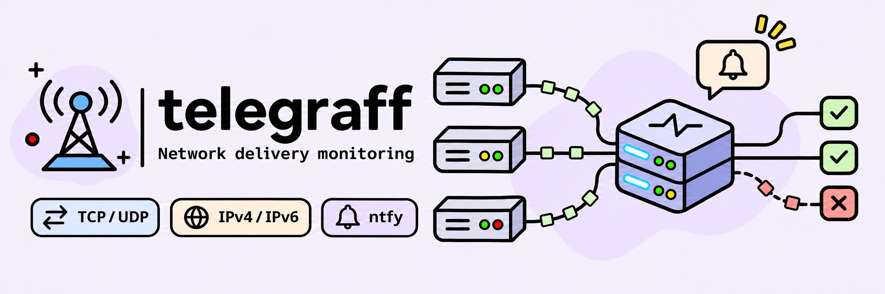

# telegraff

telegraff checks scheduled payload delivery from registered Linux servers to a hub.
One Rust executable provides both roles. TCP, UDP, IPv4, and IPv6 have separate results.
The hub sends an ntfy alert after three consecutive failed cycles for a channel.



## Requirements

Use Linux with systemd, synchronized clocks, and working DNS.
Build with Rust 1.98.1, a C compiler, and the system development headers.
On Debian or Ubuntu, install `build-essential` and `pkg-config`.
SQLite is bundled. HTTPS uses rustls and bundled public root certificates.

## Install

1. Build on a host compatible with the destination servers:

   ```sh
   cargo build --release --locked
   sudo install -m 0755 target/release/telegraff /usr/local/bin/telegraff
   sudo useradd --system --home-dir /var/lib/telegraff --shell /usr/sbin/nologin telegraff
   sudo install -d -o root -g telegraff -m 0750 /etc/telegraff
   ```

2. Copy the executable, `examples/`, and `packaging/` to each agent host. Install the executable and create the same service account and configuration directory there.

## Configure the hub

1. Copy the example configuration and create one key per agent:

   ```sh
   sudo install -m 0640 -o root -g telegraff examples/hub.toml /etc/telegraff/hub.toml
   sudo telegraff key generate --output /etc/telegraff/node-01.key
   sudo chown telegraff:telegraff /etc/telegraff/node-01.key
   ```

2. Edit `/etc/telegraff/hub.toml`. Replace `hub.example.net` with the hub DNS name or IP literal. Set `target` to the address agents use. Set the ntfy HTTPS topic URL. Save the ntfy bearer token in `/etc/telegraff/ntfy.token`, owned by `telegraff`, mode `0600`. Do not put it in a command argument. Subscribe to that topic in ntfy. For a local trial without notifications, remove the `[ntfy]` table.

3. Add one `[[agents]]` entry per server. Use a unique name and key. Set `activation` to the Unix timestamp from which monitoring must start; `0` starts at the next observed scheduled deadline. Set `families = ["ipv4"]` for an IPv4-only endpoint, `["ipv6"]` for IPv6-only, or both for dual stack. These are required channels. A missing local route counts as a failure.

4. To enroll families from DNS once, replace `families` with `auto = true`. The hub freezes the first nonempty DNS family set in SQLite. Later DNS changes appear in status. To change an enrolled set, use explicit `families` and restart. Prefer explicit families when agent and hub DNS views differ. The agent always tests every family currently advertised by DNS, including families beyond its expected set.

5. Allow inbound TCP **and** UDP port `9477` in the host and provider firewalls for each configured address family. Agents need outbound access to that port. The hub needs DNS and HTTPS access to ntfy. Remove IPv6 listener entries only if the hub has no IPv6 support.

6. Start the hub:

   ```sh
   sudo install -m 0644 packaging/telegraff-hub.service /etc/systemd/system/
   sudo -u telegraff telegraff config check --config /etc/telegraff/hub.toml
   sudo systemctl daemon-reload
   sudo systemctl enable --now telegraff-hub.service
   ```

## Configure an agent

1. Transfer only this agent's key to `/etc/telegraff/node-01.key` on the agent through an authenticated channel. Set owner `telegraff:telegraff` and mode `0600`.

2. Install and edit its configuration:

   ```sh
   sudo install -m 0640 -o root -g telegraff examples/agent.toml /etc/telegraff/agent.toml
   sudo -u telegraff telegraff config check --config /etc/telegraff/agent.toml
   ```

   Set `hub` to the hub DNS name or an unbracketed IP literal. Set `port` separately. Match `name`, `activation`, `interval`, `offset`, `grace`, `families`, `payload_bytes`, and `udp_threshold` with the hub entry. Each transfer is 150 KiB by default; each cycle sends three per protocol and family. A dual-stack cycle sends 1800 KiB of payload.

3. Install the service and timer:

   ```sh
   sudo install -m 0644 packaging/telegraff-agent.service packaging/telegraff-agent.timer /etc/systemd/system/
   sudo systemctl daemon-reload
   sudo systemctl enable --now telegraff-agent.timer
   ```

   The supplied timer matches `interval = 3600`, `offset = 0`. For another offset, change both configurations and the timer. For example, offset `300` requires minute `05` instead of `00`. Do not enable persistent catch-up or random delays.

## Verify operation

1. Wait for the next scheduled run, or run the agent during the first ten minutes after its scheduled hour:

   ```sh
   sudo systemctl start telegraff-agent.service
   sudo journalctl -u telegraff-agent.service -n 10 --no-pager
   ```

   Expected result: each required channel has a successful authenticated receipt. Without a receipt, hub acceptance is unknown to the agent. The hub may have received data successfully.

2. On the hub, inspect the matrix:

   ```sh
   sudo -u telegraff telegraff status --config /etc/telegraff/hub.toml
   sudo -u telegraff telegraff status --config /etc/telegraff/hub.toml --json
   ```

   Cycle states finalize after the grace period. `FAILING` means one or two misses. `ALERT` means three or more. A working IPv4 channel does not clear IPv6 failures. No AAAA record is acceptable when IPv6 is not expected.

3. To verify alert delivery, stop an agent timer for three expected cycles. Expect one failure notification after the third deadline plus grace. Start the timer again. Expect recovery after the next successful cycle finalizes. Reminders default to six hours; set `reminder_seconds = 0` to disable them.

## Maintenance and faults

Set `paused = true` in the hub registry and restart the hub before maintenance. Set it to `false` and restart to resume without counting the maintenance backlog. Configuration changes require a restart. Keep the SQLite file and its WAL files together during backup; use SQLite online backup for a running hub.

| Condition | Action |
|---|---|
| TCP works, UDP fails | Check UDP firewall rules and delivery loss. |
| IPv4 works, IPv6 fails | Check AAAA records, IPv6 listeners, routing, and firewalls. |
| No agent traffic | Check the timer, clock, name, key, and schedule. |
| Secret file rejected | Set mode `0600` and the service account owner. |
| Notification queued | Check ntfy URL, token, network access, and service logs. |
| DNS family warning | Compare advertised and expected families; edit the registry if intentional. |

Payloads are generated bytes. Authentication does not encrypt them. Logs and status contain technical names and aggregate results. The hub retains transfer summaries for 30 days and records observation gaps after downtime. It cannot alert while stopped: monitor its service or heartbeat from an independent system.

## Development

```sh
cargo fmt --check
cargo clippy --all-targets --locked -- -D warnings
cargo test --locked
```

See [SPEC.md](SPEC.md) for requirements. Network tests require IPv4 and IPv6 loopback.
