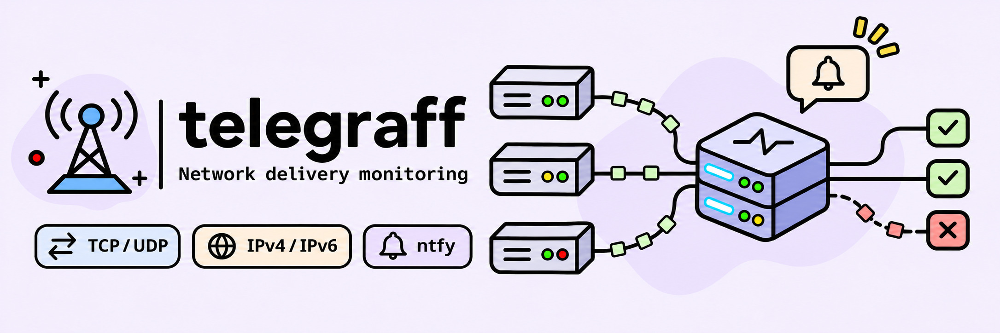

# telegraff

TCP/UDP monitoring between a hub and Linux agents, with independent IPv4/IPv6 results.
The hub alerts through ntfy after three consecutive failed intervals.



## Build

With Rust 1.98.1 installed:

```sh
sudo apt install build-essential musl-tools binutils make
make release
```

Copy `dist/telegraff` to each server. This static Linux x86-64 binary needs no glibc or shared libraries.

## Hub

```sh
./telegraff setup                 # choose hub
./telegraff register node-01      # creates node-01.toml
./telegraff hub -d
```

Setup saves `telegraff.toml`. Enter the public domain and port; local listeners default to loopback.
For nginx TLS passthrough, enable native TLS in setup or add this table at the end of the hub config:

```toml
[tls]
```

The hub reads `/etc/letsencrypt/live/<target>/fullchain.pem` and `privkey.pem`.
Issue the certificate with certbot first and grant the hub account read access. Restart after renewal.
nginx must forward TCP to the configured hub listener; UDP needs a separate forward on the same public port.
Set `public_port = 443` when agents connect through port 443. Configure ntfy in setup to enable alerts.

## Agent

Copy `node-01.toml` from the hub to the agent securely. It contains everything, including the private key.
Then run:

```sh
./telegraff setup                 # choose agent, import node-01.toml
./telegraff agent -d
```

Keep the profile private (`chmod 600 node-01.toml`). No separate key or second configuration is needed.
When registering more agents, restart the hub with `down` then `hub -d`.
Remove an agent with `./telegraff unregister NAME`; revocation requires no restart.

## Check

```sh
./telegraff status                # on hub: compact channel summary
./telegraff status -v             # history, DNS, counters and configuration details
./telegraff status --json         # machine-readable status
./telegraff config check          # validate config and TLS files
```

`ACTIVE` means the hub recently updated its own state. During the first interval, agents show how many channels
have received data: `RECEIVED` has data, `NO DATA` has none yet. `OK`/`FAIL` are completed interval results. Green is success, yellow is pending, red is failure.
Colors are automatic in terminals; `NO_COLOR=1` disables them. JSON and redirected output have no colors.
`-v` also shows time until the next interval result and dated hub downtime (UTC).
`-v` / `--verbose` works with every command; JSON requires explicit `--json`, including in pipes.

For an immediate agent check (stop the background agent first):

```sh
./telegraff down
./telegraff agent --once -v        # --json for a structured report
./telegraff agent -d
```

## Run and maintain

`--config PATH` selects another config; the default is `./telegraff.toml`.
`down` stops the matching background process. `hub -dv` / `agent -dv` enables detailed logs and prints their path.
`-d` does not enable boot startup; use the [systemd units](packaging/) for that.

More: [TLS, proxying, updates and troubleshooting](docs/operations.md),
[example configs](examples/). Configuration changes require a restart.
